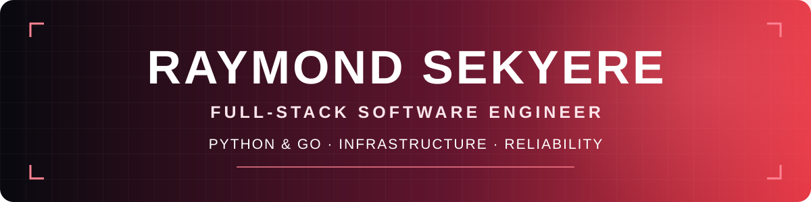

<div align="center">

<a href="https://github.com/Justraymond99"></a>


**Full-stack software engineer · Python & Go · infrastructure, distributed systems, and reliability.**

[](https://github.com/Justraymond99)

</div>

---

### `> whoami`

```go
package main

type Engineer struct {
    Focus     []string
    Languages []string
    Building  []string
    Location  string
}

var raymond = Engineer{
    Focus:     []string{"Full-Stack Engineering", "Infrastructure", "Reliability"},
    Languages: []string{"Python", "Go", "TypeScript", "JavaScript", "SQL"},
    Building:  []string{"API Gateway", "Message Broker", "Key-Value Store"},
    Location:  "New York City",
}
```

I'm a **full-stack software engineer** working extensively with **Python and Go**, with experience building end-to-end applications and a growing specialization in **backend systems, infrastructure, and production reliability**. I enjoy working through the unglamorous but important questions: What happens under concurrency? What breaks when a dependency fails? How do we know a system is healthy?

Currently sharpening my systems engineering skills through hands-on Go projects, collaborative application development, and a growing focus on testability and observability.

### `> selected_work`

<table>
<tr>
<td width="50%" valign="top">

#### 🛰️ [Aero Arc](https://github.com/Justraymond99/aero-arc-registry)
**Drone telemetry registry · backend systems**

A Go-based telemetry registry exploring agent liveness, concurrent updates, reconnection behavior, and operational visibility.

`Go` `gRPC` `Redis` `Prometheus`

[Registry](https://github.com/Justraymond99/aero-arc-registry) · [API](https://github.com/Justraymond99/aero-arc-api) · [Relay](https://github.com/Justraymond99/aero-arc-relay)

</td>
<td width="50%" valign="top">

#### 🦮 [Buddy Walk](https://github.com/Buddy-Walk/buddy-walk)
**Accessibility-oriented application · reliability**

Contributing to quality engineering, CI safeguards, failure-path testing, and observability to reduce regressions as the application grows.

[Repository](https://github.com/Buddy-Walk/buddy-walk)

</td>
</tr>
<tr>
<td width="50%" valign="top">

#### ⚙️ Ironclad Systems
**Go infrastructure projects · in progress**

Building toward an API gateway, message broker, key-value database, job scheduler, and observability platform. Focus: architecture decisions, correctness, testing, and measured tradeoffs.

`Go` `HTTP` `Concurrency` `Distributed Systems`

</td>
<td width="50%" valign="top">

#### 💪 [Final Form](https://github.com/Justraymond99/final-form-ai)
**Fitness SaaS · full-stack product engineering**

Building a fitness platform with workout tracking, progress workflows, and AI-assisted features, with attention to data access controls, auditability, and offline functionality.

`React` `TypeScript` `Supabase` `PWA`

[Repository (private)](https://github.com/Justraymond99/final-form-ai)

</td>
</tr>
</table>

### `> engineering_principles`

```text
01  Correctness before cleverness.
02  Design for failure, not just the happy path.
03  Make behavior observable.
04  Automate checks; keep humans accountable.
05  Benchmark claims. Document tradeoffs.
```

### `> toolkit`

<div align="center">

</div>

### `> current_focus`

- **Python & Go:** backend development, concurrency, context cancellation, error handling, and service lifecycle.
- **Backend architecture:** idempotency, data consistency, API design, and failure recovery.
- **Reliability engineering:** CI gates, integration tests, monitoring, and incident prevention.
- **Systems design:** turning tradeoffs into working, testable implementations.

---

<div align="center">

**BUILD IT. BREAK IT. UNDERSTAND IT. MAKE IT RELIABLE.**


</div>
